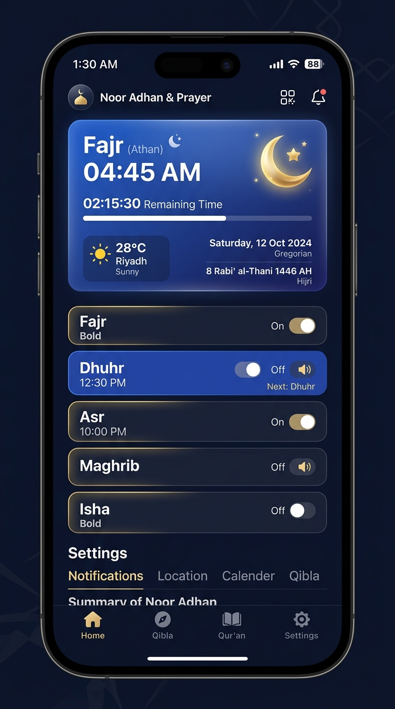

# 🕌 Sambayang Reminder — Adhan & Prayer Times

A modern, offline-first Islamic Prayer Times and Adhan reminder mobile application built with **React Native**, **Expo SDK 57**, **React 19**, and **TypeScript**.

Designed with rich Islamic aesthetics, precise astronomical calculations, adhan playback, Ramadan countdown, and daily post-salah supplications (Dua).

---

## 📸 Screenshots

| Today's Prayer Times & Adhan Player | Ramadan Countdown & Qibla / Location |
| :---: | :---: |
|  |  |

---

## ✨ Features

- **🕋 Accurate Prayer Times**: Computes Fajr, Sunrise, Dhuhr, Asr, Maghrib, and Isha using the `adhan` library with customizable calculation methods (MWL, ISNA, Egypt, Makkah, Singapore/Brunei/Malaysia JAKIM standards).
- **🌙 Ramadan Countdown & Hijri Calendar**: Real-time days and hours countdown to the holy month of Ramadan, complete with offline Islamic Hijri date calculations.
- **🔊 Adhan Audio Playback**: High-quality Adhan playback powered by `expo-audio`, including specific Fajr Adhan (*"As-salatu khayrun minan-nawm"*).
- **📿 Post-Salah Dua & Dhikr**: Interactive modal with authentic authentic post-prayer supplications in Arabic, English transliteration, and English translations.
- **📍 Location Support**: Auto-detect current coordinates via `expo-location` or select custom cities (Brunei Darussalam, Southeast Asia, and international locations).
- **🔔 Resilient Notifications**: Smart prayer alert scheduling designed defensively for Expo Go and standalone native builds.
- **🎨 Midnight Emerald Aesthetic**: Premium dark Islamic theme featuring glassmorphism cards, glowing accent colors, and custom crescent moon branding.

---

## 🛠️ Tech Stack

- **Framework**: [Expo SDK 57](https://expo.dev) (React Native 0.86, React 19)
- **Routing**: [Expo Router v4](https://docs.expo.dev/router/introduction/) (File-based navigation)
- **Calculations**: [`adhan`](https://github.com/batoulapps/adhan-js)
- **Audio**: [`expo-audio`](https://docs.expo.dev/versions/latest/sdk/audio/)
- **Animation**: React Native Reanimated
- **Language**: TypeScript (Strict typing)

---

## 🚀 Getting Started

### 1. Prerequisites
- [Node.js](https://nodejs.org/) (v18+ recommended)
- [Expo Go](https://expo.dev/go) app on Android or iOS (or an Android/iOS emulator)

### 2. Installation

Clone the repository and install dependencies:

```bash
git clone https://github.com/bensdev932/SambayangReminder.git
cd SambayangReminder
npm install
```

### 3. Running Locally

Start the Expo development server:

```bash
npx expo start
```

- Scan the QR code with your mobile device using Expo Go (Android) or the Camera app (iOS).
- Press `a` to run on Android emulator.
- Press `i` to run on iOS simulator.
- Press `w` to run in web browser.

---

## 🧪 Quality Checks

Run linting and type checking:

```bash
npx tsc --noEmit   # Typecheck
npx expo lint      # ESLint with expo config
```

---

## 📄 License

This project is licensed under the MIT License - see the [LICENSE](LICENSE) file for details.
